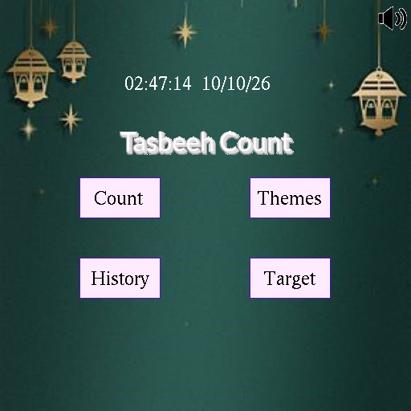

# Tasbeeh Count

A digital tasbeeh (dhikr counter) built with the [iGraphics](#credits) library in C++, made as my Level 1 Term 1 project for CSE at BUET (2023).



## Features

- **Count:** press <kbd>Space</kbd> to count, with an animated tasbeeh, a session timer, and **-1** / **Reset** buttons. Save a count under your name and the dua you were reading.
- **History:** every saved count, grouped by user. Pick a saved dua to continue counting where you left off. Right-click a user or dua to rename or delete it.
- **Target:** set a **daily** or **weekly** goal for a dua. Goals show their time left, a green tick when completed, or a red cross when missed. The main menu tells you when a goal is unfinished.
- **Themes:** green, purple and blue backgrounds.
- **Sound:** background music, a water-drop sound on every count, and a chime when you reach a goal. Each can be muted from the speaker icon in the top-right corner.

## Running it

### Linux

Install a compiler and freeglut (Ubuntu/Debian):

```sh
sudo apt install build-essential freeglut3-dev
```

Then, from the project folder:

```sh
make run
```

`make` builds into `build/`, and `make run` builds and starts the game. Run it from the project folder, because images, sounds and saved data are loaded by relative path.

### Windows

The original version was built with Code::Blocks and MinGW. Open `Tasbeeh Count.cbp`, add `miniaudio.c` and `iSound.h` to the project, and build. GLUT must be set up in MinGW as in the usual iGraphics setup, linking `opengl32`, `glu32` and `glut32`. The current version has only been tested on Linux.

## Controls

| Input | Action |
|---|---|
| Left click | Buttons, menu items, list entries |
| Right click | Rename / delete menu on a list entry |
| <kbd>Space</kbd> | Count +1 (on the count page) |
| <kbd>Enter</kbd> | Confirm text input / go back from messages |
| Drag the scrollbar | Scroll long lists |

## Project layout

```
iMain.cpp          the game: drawing, input and file handling
iGraphics.h        iGraphics library (ported to also build on Linux)
iSound.h           small sound helpers built on miniaudio
miniaudio.h/.c     audio library
stb_image.h        image loader used by iGraphics
pictures/          backgrounds, tasbeeh frames, icons, dialog boxes
music/             background music and sound effects
data_files/        saved data
  regular_reads/     history: participant_list.txt + one participantN.txt per user
  targetted_reads/   targets: same layout, plus deadline and completion status
```

Saved data is plain text, one entry per line, for example:

```
01. Bismillah - 17 - 3                       history:  dua - count - seconds spent
01. Darud - 45 - 54 1685987915 1             target:   dua - target - count, deadline, done
```

## Known limitations

- Up to 15 users and 10 duas per user. Can be changed by editing `MAX_PARTICIPANTS` and `MAX_DUAS` in `iMain.cpp`. But intended design was to keep both limited, so the UI doesn't get too crowded.

## Credits

- **iGraphics:** S. M. Shahriar Nirjon; updated by Mohammad Saifur Rahman.
- **[stb_image](https://github.com/nothings/stb):** Sean Barrett (public domain / MIT).
- **[miniaudio](https://miniaud.io):** David Reid (public domain / MIT-0).
